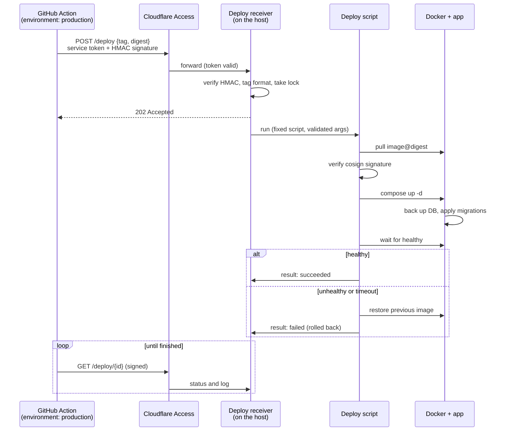

# CI/CD and deployment

How a change gets from a pull request to production. The repo contains nothing specific to where it is hosted (see [security.md](security.md)): hostnames, addresses and tokens live in GitHub Environment secrets and in the private hosting configuration, never here.

**Status:** the application side is built and live: every merge to `main` builds, scans, signs and publishes the image and cuts a GitHub Release. The automatic deploy job is switched off (repository variable `DEPLOY_ENABLED`) until the host runs the deploy receiver; see [Turning deploys on](#turning-deploys-on).

## Principles

- **One branch: `main`.** There are no release branches, no release PRs and no long-lived branches of any kind. Feature branches live only as long as their pull request.
- **Everything merged to `main` is releasable and is deployed as soon as it is merged.** If it is not ready for production, it does not merge (or it merges behind a switch that keeps it off).
- **Tags identify releases.** Every deploy is tagged, automatically, on the commit that shipped. A tag records what was released; it never triggers or gates anything.
- **The approval is the pull request.** Review and passing checks happen before merge, because merge is the release.
- **Nothing polls.** GitHub pushes the deploy to the host.
- **Build once, deploy that artifact.** The image that was tested is the image that is deployed, by digest.
- **Migrations are automatic and safe**, and a deploy that does not come up healthy rolls itself back.

## Overview

```mermaid
flowchart LR
    dev[Developer] -->|feature branch| pr[Pull request]
    pr --> ci[CI: lint, test,<br/>migration test,<br/>image smoke test]
    ci --> review{Review +<br/>checks pass}
    review -->|merge| main[(main)]
    main --> build[Build image once<br/>scan, push to GHCR, sign]
    build --> tag[Tag the commit<br/>vYYYY.MM.DD.N]
    tag --> deploy[Deploy job<br/>environment: production]
    deploy -->|HMAC + access token| hook[Deploy receiver<br/>on the host]
    hook --> run[Pull by digest, verify<br/>signature, back up, migrate,<br/>health check]
    run -->|ok| done([Live])
    run -->|unhealthy| rb[Roll back to<br/>previous image]
    run -.->|polled result| gh[Action run + GitHub Deployment]
    rb -.-> gh
```

There is a single path to production: merge to `main`. Reverting a bad change is also a merge to `main`.

## Pull requests (the gate)

Branch protection on `main`:

- Changes reach `main` only through a pull request.
- Required status checks: lint, tests, the migration test and the image smoke test.
- **Branches must be up to date before merging**, so the commit that lands on `main` is the one CI tested. (A merge queue is the stronger version of this if it is ever needed.)
- Force pushes and deletion of `main` are blocked.

Required approving reviews are covered under [risks](#failure-modes-and-open-risks): with a single maintainer GitHub cannot require an approval from someone other than the author.

Because merge is release, a change must be safe to run in production the moment it lands:

- **Migrations are additive** (expand/contract): add columns and tables first, stop using old ones in a later change, drop them later. That keeps the previous image runnable against the new schema, which is what makes rollback safe.
- **Unfinished work stays off**, behind a setting or by not linking to it, until it is ready.
- **Documentation-only changes do not deploy.** The workflow ignores changes that touch only `docs/`, `*.md`, or issue templates.

## Build, tag, publish

Runs on every push to `main`, from the merge commit.

1. Build the image (the existing multi-stage Dockerfile).
2. **Smoke test the built image:** start it against an empty data dir, then check `/healthz` and `/radio/stream`.
3. Scan for known vulnerabilities; fail on critical findings.
4. Push to GHCR as `sha-<commit>` and the release tag; record the **digest**.
5. Sign the digest with [cosign](https://docs.sigstore.dev/) keyless signing, using the workflow's GitHub OIDC identity. No signing key to store.
6. Create the release tag on the commit and a GitHub Release with generated notes (the merged PR titles).

Release tags are **`vYYYY.MM.DD.N`**, where `N` counts that day's releases (`v2026.11.01.1`, `v2026.11.01.2`). This is an application, not a library, so there is no API compatibility for a version number to promise, and no human has to decide a version bump. Tag only after the image is built, signed and pushed. The tag is created by the workflow's `GITHUB_TOKEN`, which deliberately cannot start another workflow, so tagging never causes a second run. Nothing listens for tags.

Deployments reference the **digest**, never a mutable tag.

## Deploy: GitHub pushes, nothing polls

The homelab is not reachable from the internet, so GitHub cannot connect to it directly. It already holds an outbound tunnel open to Cloudflare, and the deploy rides that.

The request returns `202` and a deploy id immediately, because Cloudflare cuts proxied requests at about 100 seconds and a deploy can take longer. The Action then asks the receiver for that id's status over the same signed, tunnelled path until it finishes, prints the deploy log, and goes green or red. The host holds no GitHub credential at all. The job runs in the `production` environment, so GitHub records it as a Deployment and the outcome is visible in GitHub.

### Concurrency

Deploys are serialized by a workflow `concurrency` group that does not cancel a running deploy. If several merges land while one deploy is running, only the newest waits; the ones in between are skipped. That is correct, because every deploy ships the whole of `main` at that commit. The receiver also takes its own lock and answers a second simultaneous request with `409`.

### Receiver rules

The receiver is a network-reachable path to "run a deploy", so it is deliberately dumb:

- It accepts only `{tag, digest}`. The tag must match `^v\d{4}\.\d{2}\.\d{2}\.\d+$` and the digest `^sha256:[0-9a-f]{64}$`. It never accepts a command, a path or an image name.
- The image repository is fixed in the script, not taken from the request.
- It verifies an HMAC over the body (shared secret) in addition to the Cloudflare Access service token.
- One deploy at a time (lock).
- The script verifies the cosign signature against this repository's workflow identity before starting anything, so a stolen token cannot deploy an arbitrary image.
- It runs as an unprivileged user that can use Docker and nothing else.
- Requests are idempotent: redeploying the running digest is a no-op success.

### Where things live

| Piece | Location |
|---|---|
| Workflow: build, sign, tag, deploy call | this repo (`.github/workflows/`, `.github/actions/deploy`) |
| Deploy receiver (`server/cmd/deployhook`) and deploy script (`deploy/deploy.sh`) | this repo; published as assets of every GitHub Release |
| Hook URL, access token, HMAC secret | GitHub Environment `production` secrets |
| Environment rule: deploy only from `main` | GitHub Environment `production` |
| Installing the receiver, tunnel route, access policy, host paths | private hosting configuration, not this repo |

## Database migrations

Migrations already run automatically: `storage.Open` applies every embedded `NNNN_*.sql` newer than `PRAGMA user_version`, each in its own transaction. They are forward-only. Three additions make that safe to automate:

1. **Backup before migrating.** If any migration is pending, first copy the database to `<data-dir>/backups/pre-v<N>-<timestamp>.db` with SQLite `VACUUM INTO`, and keep the most recent few. A rollback across a migration means restoring the matching backup.
2. **Downgrade guard.** If the database's `user_version` is newer than the migrations embedded in the binary, refuse to start with a clear error rather than run old code on a newer schema. The deploy script's automatic rollback uses this: it reverts the image only when the schema has not moved, and otherwise restores the pre-migration backup first.
3. **Migration test in CI.** On every PR, build the current code, apply it to a fixture database from the previous release, and check it migrates and the data survives.

## Rollback

| Situation | What happens |
|---|---|
| New deploy fails its health check, no migration ran | Previous image restored automatically. |
| New deploy fails after a migration ran | Pre-migration backup restored, previous image restored. Content edits made in the window are lost; the window is the health-check timeout. |
| A bad change is found later | Revert it with a pull request. That merges to `main` and deploys like anything else (roll forward). |
| `main` is broken and the host needs the last good release now | Run the deploy workflow manually (`workflow_dispatch`) and give it an existing release tag. It redeploys that tag's signed image through the same path; it does not build or branch anything. Then fix forward on `main`. |
| A data problem | Restore a named backup by hand. |

## Failure modes and open risks

- **Merge is release.** There is no second gate after merge. The controls are the required checks, the up-to-date rule, additive migrations and the automatic health-checked rollback.
- **Solo maintainer and required reviews.** GitHub does not let an author approve their own PR. With one human, "require an approving review" would block every merge, or has to be bypassed. Until there is a second reviewer, the gate is the required status checks, with the PR still serving as a recorded, reviewable change. The checks therefore have to carry real weight, which is why the migration test and image smoke test are required.
- **Receiver exposure:** the deploy path is reachable through the tunnel. It is gated by Cloudflare Access, the HMAC, the input allowlist, the fixed script and signature verification. It is still new attack surface compared with a polling design.
- **Rollback window data loss:** restoring a pre-migration backup discards changes made after the migration. Keep the health-check timeout short.
- **GHCR availability:** if the registry is down, the deploy fails and the running release is untouched.
- **Frequent deploys:** every deploy restarts the app, briefly dropping live radio listeners. Acceptable at current scale; worth revisiting if deploys become frequent or the audience grows.

## Turning deploys on

The `deploy` job runs only when the repository variable `DEPLOY_ENABLED` is `true`, so the pipeline can ship images before a host is listening. Once the host side is installed:

1. Set the `production` environment secrets: `DEPLOY_URL`, `DEPLOY_ACCESS_CLIENT_ID`, `DEPLOY_ACCESS_CLIENT_SECRET`, `DEPLOY_HMAC_SECRET` (the HMAC value must match the receiver's secret).
2. Set the repository variable `DEPLOY_ENABLED=true`.
3. Dry run: merge a trivial change and watch the Action; then prove the rollback with a deliberately failing health check, including one after a migration.

The receiver and script are built from this repo and attached to every release (`deployhook`, `deploy.sh`, `SHA256SUMS`). `deploy/deploy.sh` documents the environment it expects; `deploy/test-deploy.sh` exercises it against stubbed Docker and cosign, including rollback.

## How it is enforced

- Ruleset on `main`: pull requests only, `test` and `docker` checks required, branch must be up to date, no force push or deletion.
- `production` environment: deployments only from `main`.
- `release.yml` is the signer identity `deploy.sh` accepts; renaming that file means updating the script.
- The smoke test (`scripts/smoke-test.sh`) starts the built image on an empty data dir and checks `/healthz`, the public site and the admin API. It does not reach the radio upstream, which CI cannot depend on; the relay itself is covered by the Go tests.
