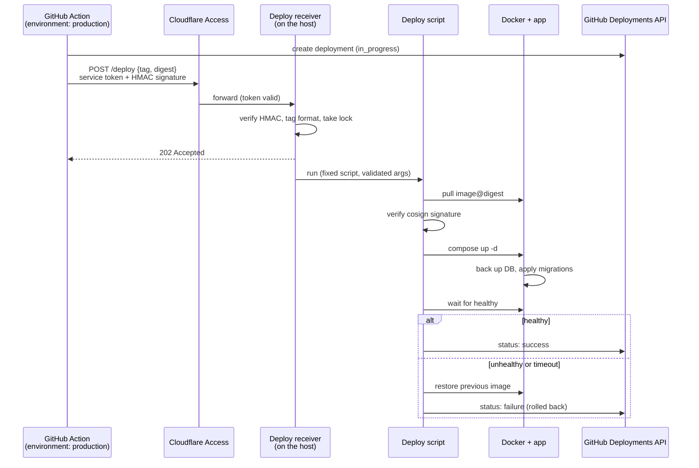

# CI/CD and deployment

How a change gets from a pull request to production. The repo contains nothing specific to where it is hosted (see [security.md](security.md)): hostnames, addresses and tokens live in GitHub Environment secrets and in the private hosting configuration, never here.

**Status:** designed, not yet built. The pieces are tracked in the implementation issue. Today the image is built in CI but not published, and a release is a manual redeploy.

## Goals

- A release is one deliberate, reviewed action: **approve and merge a release PR**.
- Nothing polls. GitHub pushes the deploy to the host.
- Database migrations run automatically on start, safely, and a bad release can be undone.
- A deploy that does not come up healthy rolls itself back.
- The image that was tested is the image that is deployed (built once, deployed by digest).

## Overview

```mermaid
flowchart LR
    dev[Developer] -->|feature PR| ci[CI: lint, test,<br/>migration test]
    ci -->|merge| main[(main)]
    main --> rp[release-please<br/>keeps a release PR open]
    rp -->|release PR<br/>version + changelog| review{Review and<br/>approve}
    review -->|merge| tag[Tag vX.Y.Z]
    tag --> build[Build image once<br/>smoke test, scan,<br/>push to GHCR, sign]
    build --> deploy[Deploy job<br/>environment: production]
    deploy -->|HMAC + access token| hook[Deploy receiver<br/>on the host]
    hook --> run[Pull by digest, verify<br/>signature, backup, migrate,<br/>health check]
    run -->|ok| done([Live])
    run -->|unhealthy| rb[Roll back to<br/>previous image]
    run -.->|result| gh[GitHub Deployments]
    rb -.-> gh
```

Merging ordinary PRs to `main` never deploys. Only merging the release PR does, so there is always a review gate and a clear record of what shipped and when.

## Release PR (the approval gate)

[release-please](https://github.com/googleapis/release-please) watches `main`. It keeps one **release PR** open that bumps the version and writes the changelog from [Conventional Commit](https://www.conventionalcommits.org/) messages (`feat:`, `fix:`, and so on).

- The release PR is authored by the Actions bot, so a human can approve it. GitHub does not let you approve your own PR, which is why the release is not opened by hand.
- Branch protection on `main` requires one approving review and passing checks. That review is the production approval.
- Merging it creates the `vX.Y.Z` tag and the GitHub Release, and deploys.

Because a tag created with the default `GITHUB_TOKEN` does not trigger other workflows, release-please, the build and the deploy run as **jobs of one workflow** on push to `main`. The build and deploy jobs run only when release-please reports a release was created.

## Build and publish

Runs once per release, from the tagged commit.

1. Build the image (the existing multi-stage Dockerfile).
2. **Smoke test the built image:** start it against an empty data dir, then check `/healthz` and `/radio/stream`.
3. Scan for known vulnerabilities; fail on critical findings.
4. Push to GHCR as `vX.Y.Z` and `sha-<commit>`; record the **digest**.
5. Sign the digest with [cosign](https://docs.sigstore.dev/) keyless signing, using the workflow's GitHub OIDC identity. No signing key to store.

Deployments reference the **digest**, never a mutable tag.

## Deploy: GitHub pushes, nothing polls

The homelab is not reachable from the internet, so GitHub cannot connect to it directly. It already holds an outbound tunnel open to Cloudflare, and the deploy rides that.

The request returns `202` immediately and the host reports the outcome afterwards, because Cloudflare cuts proxied requests at about 100 seconds and a deploy can take longer. The Action run turns green or red from the Deployments status, so the real outcome is visible in GitHub.

### Receiver rules

The receiver is a network-reachable path to "run a deploy", so it is deliberately dumb:

- It accepts only `{tag, digest}`. The tag must match `^v\d+\.\d+\.\d+$` and the digest `^sha256:[0-9a-f]{64}$`. It never accepts a command, a path or an image name.
- The image repository is fixed in the script, not taken from the request.
- It verifies an HMAC over the body (shared secret) in addition to the Cloudflare Access service token.
- One deploy at a time (lock); a second request while one runs gets `409`.
- The script verifies the cosign signature against this repository's workflow identity before starting anything, so a stolen token cannot deploy an arbitrary image.
- It runs as an unprivileged user that can use Docker and nothing else.
- Requests are idempotent: redeploying the running digest is a no-op success.

### Where things live

| Piece | Location |
|---|---|
| Workflow: release PR, build, sign, deploy call | this repo (`.github/workflows/`) |
| Hook URL, access token, HMAC secret | GitHub Environment `production` secrets |
| Environment rules: deploy only from tags/`main` | GitHub Environment `production` |
| Receiver, deploy script, tunnel route, access policy | private hosting configuration, not this repo |
| Token for writing Deployment status | host-side secret, scoped to `deployments: write` on this repo only |

## Database migrations

Migrations already run automatically: `storage.Open` applies every embedded `NNNN_*.sql` newer than `PRAGMA user_version`, each in its own transaction. They are forward-only. Three additions make that safe to automate:

1. **Backup before migrating.** If any migration is pending, first copy the database to `<data-dir>/backups/pre-v<N>-<timestamp>.db` with SQLite `VACUUM INTO`, and keep the most recent few. A rollback to an older release means restoring the matching backup.
2. **Downgrade guard.** If the database's `user_version` is newer than the migrations embedded in the binary, refuse to start with a clear error rather than run old code on a newer schema. This is also what makes the deploy script's automatic rollback safe: it only reverts the image when the schema has not moved, and otherwise restores the pre-migration backup first.
3. **Migration test in CI.** On every PR, build the current code, apply it to a fixture database from the previous release, and check it migrates and the data survives. New migrations must be additive where possible so the previous image still runs against the new schema during a rollback window.

## Rollback

| Situation | What happens |
|---|---|
| New release fails its health check, no migration ran | Previous image restored automatically. |
| New release fails after a migration ran | Pre-migration backup restored, previous image restored. Content edits made in the window are lost; the window is the health-check timeout. |
| A bad release is found later | Revert the change, merge the next release PR (forward fix). For a data problem, restore a named backup by hand. |

## Failure modes and open risks

- **Receiver exposure:** the deploy path is reachable through the tunnel. It is gated by Cloudflare Access, the HMAC, the input allowlist, the fixed script and signature verification. It is still new attack surface compared with a polling design.
- **Repo compromise:** anyone who can merge a release PR can ship to production. Branch protection with a required review is the control; the release PR being bot-authored means a second person (or the owner) must approve it.
- **Solo maintainer:** with one human, the reviewer is the same person who merged the feature PRs. The gate still gives a deliberate, recorded release step, but it is not independent review.
- **Rollback window data loss:** restoring a pre-migration backup discards changes made after the migration. Keep the health-check timeout short.
- **GHCR availability:** if the registry is down, the deploy fails and the running release is untouched.

## Implementation order

1. App: pre-migration backup and downgrade guard, plus the migration CI test.
2. Workflow: release-please, build once, smoke test, scan, push, sign.
3. Hosting: receiver, deploy script, tunnel route and access policy; switch the app from build-on-host to pulling the signed image, with a compose health check.
4. Workflow: `production` environment, deploy job, Deployments status.
5. Dry run with a throwaway release, including a deliberately failing health check to prove the rollback.
