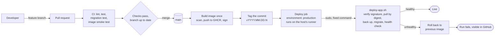
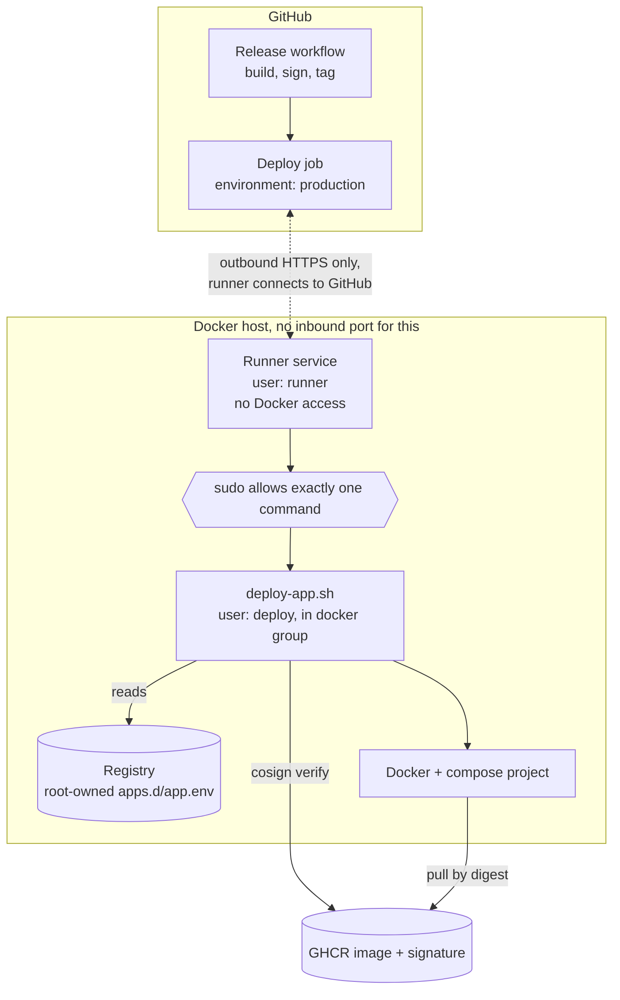
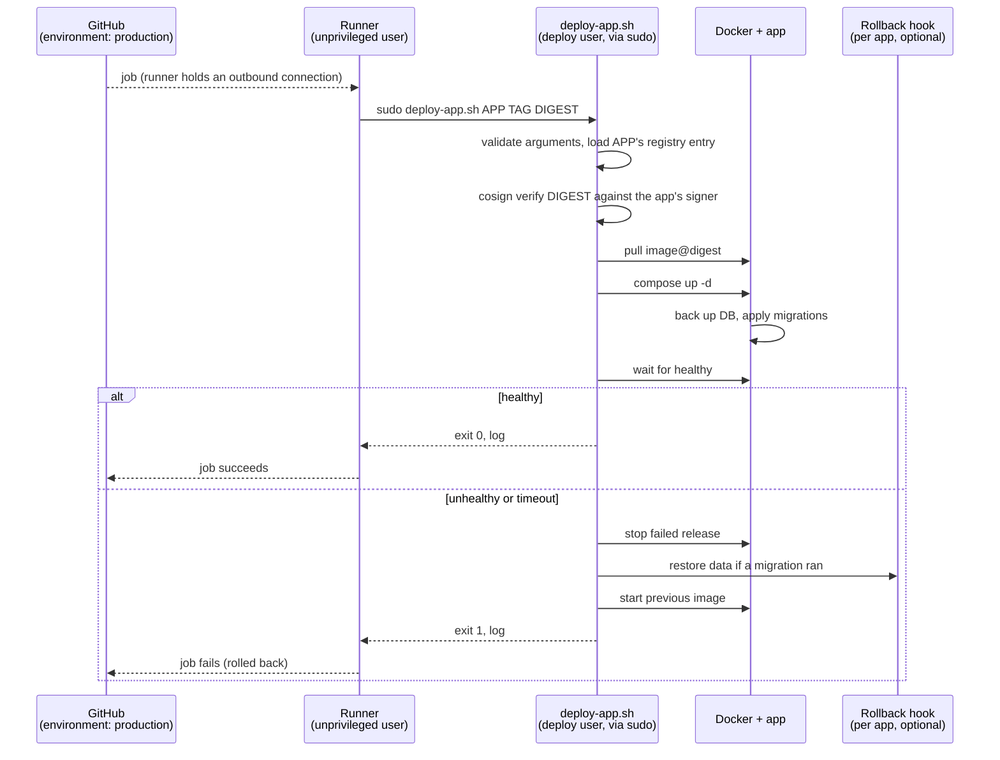

# CI/CD and deployment

How a change gets from a pull request to production. The repo contains nothing specific to where it is hosted (see [security.md](security.md)): hostnames, addresses and tokens live in the private hosting configuration, never here.

**Status:** the application side is built and live: every merge to `main` builds, scans, signs and publishes the image and cuts a GitHub Release. The deploy job is written but switched off (repository variable `DEPLOY_ENABLED`) until a runner exists on the host; see [Turning deploys on](#turning-deploys-on).

## Principles

- **One branch: `main`.** There are no release branches, no release PRs and no long-lived branches. Feature branches live only as long as their pull request.
- **Everything merged to `main` is releasable and is deployed as soon as it is merged.** If it is not ready for production, it does not merge (or it merges behind a switch that keeps it off).
- **Tags identify releases.** Every deploy is tagged, automatically, on the commit that shipped. A tag records what was released; it never triggers or gates anything.
- **The approval is the pull request.** Review and passing checks happen before merge, because merge is the release.
- **GitHub pushes the deploy; the host opens no inbound port.** A runner on the host keeps an outbound connection to GitHub and receives the deploy job.
- **Build once, deploy that artifact.** The image that was tested is the image that is deployed, by digest, after its signature is verified.
- **The host grants CI one narrow capability:** "deploy a signed image of a registered app". Not a shell, not Docker.
- **Migrations are automatic and safe**, and a deploy that does not come up healthy rolls itself back.

## Overview



There is a single path to production: merge to `main`. Reverting a bad change is also a merge to `main`.

## Pull requests (the gate)

Branch protection on `main` (a repository ruleset):

- Changes reach `main` only through a pull request.
- Required status checks: `test` (lint, unit tests, migration fixtures, deploy-script tests) and `docker` (image build and smoke test).
- **Branches must be up to date before merging**, so the commit that lands on `main` is the one CI tested.
- Force pushes and deletion of `main` are blocked.

With a single maintainer GitHub cannot require an approval from someone other than the author, so required reviews are off and the required checks carry the weight (see [risks](#failure-modes-and-open-risks)).

Because merge is release, a change must be safe to run in production the moment it lands:

- **Migrations are additive** (expand/contract): add columns and tables first, stop using old ones in a later change, drop them later. That keeps the previous image runnable against the new schema, which is what makes rollback safe.
- **Unfinished work stays off**, behind a setting or by not linking to it, until it is ready.
- **Documentation-only changes do not deploy.** The release workflow ignores changes that touch only `docs/`, `*.md`, or issue templates.

## Build, tag, publish

Runs on every push to `main`, from the merge commit, on GitHub-hosted runners.

1. Run the full CI workflow again on the merge commit.
2. Build the image (the multi-stage Dockerfile) and push it to GHCR as `sha-<commit>` and the release tag; record the **digest**.
3. Scan for known vulnerabilities; fail on critical findings.
4. Sign the digest with [cosign](https://docs.sigstore.dev/) keyless signing, using the workflow's GitHub OIDC identity. No signing key exists to steal or rotate.
5. Create the release tag on the commit and a GitHub Release with generated notes.

Release tags are **`vYYYY.MM.DD.N`**, where `N` counts that day's releases. This is an application, not a library, so there is no compatibility promise for a version number to carry and nobody has to choose a bump. The tag is created by the workflow's `GITHUB_TOKEN`, which cannot start another workflow, so tagging never causes a second run. Nothing listens for tags.

Deployments reference the **digest**, never a mutable tag.

## Deploy: a runner on the host

The homelab is not reachable from the internet, so GitHub cannot connect to it. Instead a [self-hosted runner](https://docs.github.com/actions/hosting-your-own-runners) on the host keeps an outbound HTTPS connection to GitHub and is handed the deploy job. There is no tunnel route, access policy, shared secret or receiver service for deploys. The run in GitHub is the log, the status, and (through the `production` environment) the Deployment record.



### Sequence



### The one command the runner may run

The runner's user has no Docker access and no other privileges. `sudoers` lets it run exactly one thing, as the `deploy` user (which is in the `docker` group):

```
runner ALL=(deploy) NOPASSWD: /usr/local/lib/deploy-kit/deploy-app.sh
```

`sudo` resets the environment, so the script receives only its three arguments: `APP TAG DIGEST`. It validates each, then reads everything else from a registry on the host that only root can edit. A workflow, and anyone who can change one, cannot name an image, a path, a service or a command; it can only pick a registered app and a release to deploy, and that release must carry a valid signature from the app's own workflow.

### Registry

One file per app in `/etc/deploy-kit/apps.d/<app>.env` (name `^[a-z][a-z0-9-]{0,31}$`), root-owned and not writable by `runner` or `deploy`. The script parses `KEY=VALUE` lines; it never sources the file. It is read on each deploy, so adding an app needs no restart.

| Key | Meaning |
|---|---|
| `IMAGE_REPO` | Image repository, e.g. `ghcr.io/owner/app`. |
| `SIGNER_RE` | Anchored regexp for the cosign identity the image must be signed by (this repo's `release.yml` on `refs/heads/main`). |
| `DEPLOY_DIR` | Compose project directory. The script writes `.deploy.env` here. |
| `SERVICE` | Compose service to wait on; must define a healthcheck. |
| `IMAGE_VAR` | Compose variable holding the image reference (`image: ${MUDDYS_IMAGE}`). |
| `TAG_RE` | Optional. Allowed tag format; defaults to `vYYYY.MM.DD.N`. |
| `HEALTH_WAIT` | Optional. Seconds to wait for healthy. |
| `ROLLBACK_HOOK`, `HOOK_*` | Optional. Executable run after a failed release is stopped and before the previous one starts, with `HOOK_*` in its environment. This app uses `deploy/rollback-db.sh` to restore the pre-migration database backup. |

### Runner hardening

This repository is public, and a self-hosted runner executes whatever a workflow tells it to. These rules keep it to deploy jobs only:

- **Only the deploy job targets the runner**, and only after the build on `main`. No pull-request-triggered workflow uses the runner label, ever.
- Repository setting: **require approval for all outside collaborators** before any workflow runs, and no secrets are exposed to fork pull requests.
- The deploy job uses the `production` environment, which only accepts deployments from `main`.
- The `main` ruleset means a workflow change reaches the runner only through a merged pull request.
- The runner service runs as an **unprivileged user with no Docker access**; the sudo rule above is its only elevation.
- Runner is registered to this repository only (personal accounts have no runner groups); it needs outbound HTTPS to GitHub and nothing inbound.
- Prefer an **ephemeral** runner (one job, then re-registered) if the setup allows; a persistent runner must be kept updated, which it does itself.

### Concurrency

A runner executes one job at a time, so deploys are naturally serialized. The workflow `concurrency` group for deploys does not cancel a running deploy; if several merges land while one deploys, only the newest waits, which is correct because every deploy ships all of `main` at that commit. If the runner is offline, the job waits (and fails after GitHub's queue timeout), visibly, without touching the running release.

### Where things live

| Piece | Location |
|---|---|
| Workflows: build, sign, tag, deploy job, redeploy dispatch | this repo (`.github/workflows/`) |
| `deploy-app.sh` and its tests | the shared deploy-kit repo, installed on the host at a pinned version and checksum |
| Rollback hook for this app (`deploy/rollback-db.sh`) | this repo |
| Runner install, user, sudoers rule, registry entries, compose project, outbound firewall rule | private hosting configuration, not this repo |
| Environment rule: deploy only from `main` | GitHub Environment `production` |
| Deploy credentials | none; the runner is registered with a one-time token during setup |

## Database migrations

Migrations already run automatically: `storage.Open` applies every embedded `NNNN_*.sql` newer than `PRAGMA user_version`, each in its own transaction. They are forward-only. Three additions make that safe to automate:

1. **Backup before migrating.** If any migration is pending, first copy the database to `<data-dir>/backups/pre-v<N>-<timestamp>.db` with SQLite `VACUUM INTO`, and keep the most recent few. A rollback across a migration means restoring the matching backup.
2. **Downgrade guard.** If the database's `user_version` is newer than the migrations embedded in the binary, refuse to start rather than run old code on a newer schema.
3. **Migration test in CI.** Every PR opens each frozen release database in `server/internal/storage/testdata` with the current code and checks it migrates and the data survives.

## Rollback

| Situation | What happens |
|---|---|
| New deploy fails its health check, no migration ran | Previous image restored automatically; the run fails. |
| New deploy fails after a migration ran | Failed release stopped, the rollback hook restores the pre-migration backup, previous image restored. Content edits made in the window are lost; the window is the health-check timeout. If the hook itself fails, the app is left stopped rather than starting old code on unknown data. |
| A bad change is found later | Revert it with a pull request. That merges to `main` and deploys like anything else (roll forward). |
| `main` is broken and the host needs the last good release now | Run the redeploy workflow manually (`workflow_dispatch`) with an existing release tag. It redeploys that tag's signed image through the same path; it builds nothing. Then fix forward on `main`. |
| A data problem | Restore a named backup by hand. |

## Failure modes and open risks

- **Merge is release.** There is no second gate after merge. The controls are the required checks, the up-to-date rule, additive migrations, signature verification and the automatic health-checked rollback.
- **Solo maintainer and required reviews.** GitHub does not let an author approve their own PR, so required reviews are off. The checks carry real weight, which is why the migration fixtures and image smoke test are required.
- **The runner is broader than a single-purpose receiver would be.** It executes workflow code on the host. What limits the damage is that the runner user has no Docker access and a single sudo-able command, so a compromised workflow can at worst ask to deploy a registered app's release signed by that app's own workflow. It cannot read other apps' data, start arbitrary containers or change the registry.
- **Repository compromise still matters.** Someone who can push to `main` can ship a new signed image. The ruleset, 2FA on the account and the `production` environment are the guard; signature verification proves *which workflow* built an image, not that the code is good.
- **Docker access is root-equivalent.** The `deploy` user can start privileged containers, so `deploy-app.sh` must stay root-owned, argument-validated and unmodifiable by `runner`.
- **Rollback window data loss:** restoring a pre-migration backup discards changes made after the migration. Keep the health-check timeout short.
- **GHCR availability:** if the registry is down, the deploy fails and the running release is untouched.
- **Frequent deploys:** every deploy restarts the app, briefly dropping live radio listeners. Acceptable at current scale; worth revisiting if deploys become frequent or the audience grows.

## Turning deploys on

The `deploy` job runs only when the repository variable `DEPLOY_ENABLED` is `true`, so the pipeline can ship images before a runner exists.

1. Install the runner, the `runner` and `deploy` users, the sudoers rule, `deploy-app.sh`, `cosign`, the registry entry and the compose project on the host (private hosting configuration).
2. Confirm the runner shows as online for this repository.
3. Set the repository variable `DEPLOY_ENABLED=true`.
4. Dry run: merge a trivial change and watch the run, then prove the rollback with a deliberately failing health check, including one after a migration.

## Adding another app

One registry entry on the host and one compose project; a repository whose release workflow builds, signs and pushes an image and whose deploy job calls `deploy-app.sh` on a runner registered for that repository. No receiver, tunnel route or secret is added.

## How it is enforced

- Ruleset on `main`: pull requests only, `test` and `docker` checks required, branch must be up to date, no force push or deletion.
- `production` environment: deployments only from `main`.
- `release.yml` is the signer identity the registry entry accepts; renaming that file means updating the entry.
- The smoke test (`scripts/smoke-test.sh`) starts the built image on an empty data dir and checks `/healthz`, the public site and the admin API. It does not reach the radio upstream, which CI cannot depend on; the relay is covered by the Go tests.
